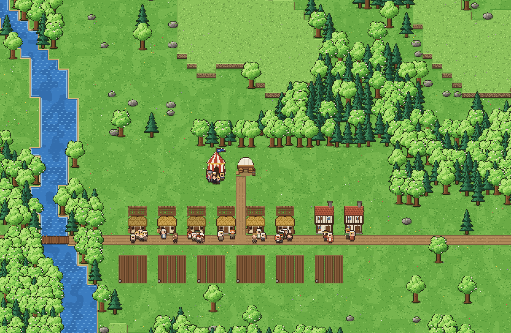
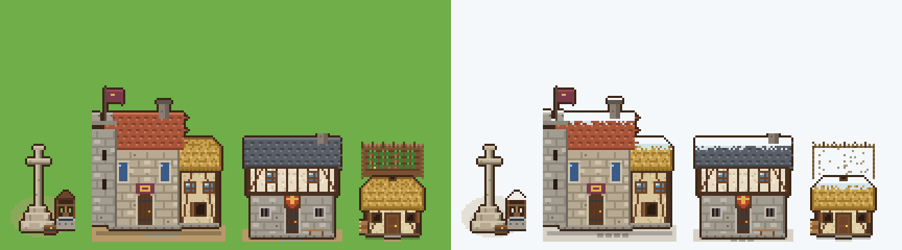
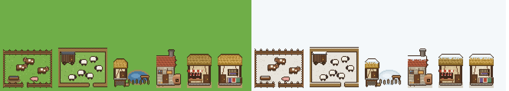
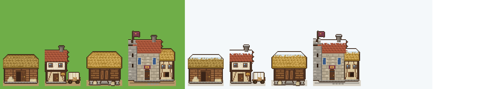
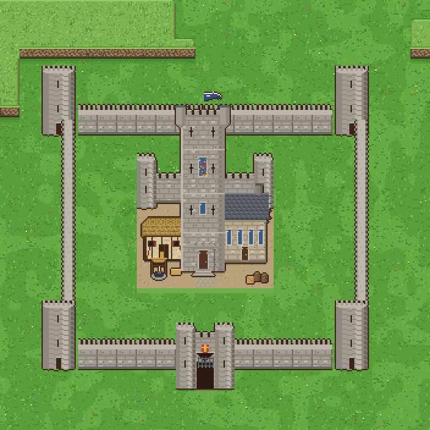
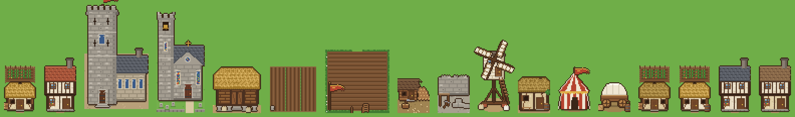
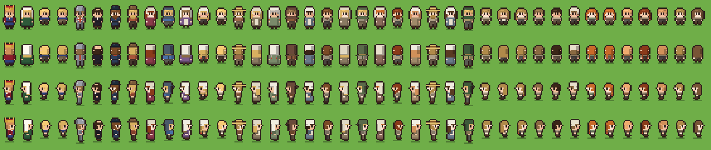

# Medieval Town

A medieval village in the same chunky 3/4 pixel-art style as Frontier Ledger. The king lives on the map, and the village is
NPC-run around a **realm** of villages and a **tax chain** that climbs it: serfs → reeve → baron → steward → king.

You're the unseen hand: you lay out the capital, found new villages around it, decide which of them get a baron, and set
the laws. The people live their lives.

Built in Unity 6 (6000.6.5f1). All art is generated in code, so there are no image assets. The art engine
(pixel canvas, terrain, trees, people, camera, UI kit and pixel font) is forked from Frontier Ledger.
The simulation is new.

## Open it

1. Unity Hub → **Add** → **Add project from disk** → pick this folder.
2. Open it with Unity 6000.6.5f1.
3. The first time it opens, the project creates `Assets/Scenes/Main.unity` and opens it.
4. Press **Play**. The game builds itself from code, so the scene stays empty in the editor.

The manor saves once a week and when you quit, to `Application.persistentDataPath/medieval-town-save-v1.json`. Saves from before the realm (v0.3) start a new reign.
**Start a new manor** is at the bottom of the Manor Rules book.

## The start

A new king comes to an old village of six serf families with their cottages and strips in the open field, two freemen
and a track through the middle. There is no castle, no church and no mill. The royal family, a knight, a priest and the
king's steward arrive with a pavilion and a baggage cart.

A sound opening:

1. **Royal Granary**: the cart is unloaded into it.
2. **Woodward's Lodge** and **Quarry**: freemen fell timber and break stone. Serfs on week-work help when sites wait.
3. **Windmill**: everyone must grind at the king's mill and leave the crown's share. Bread goes further than pottage.
4. **Steward's Hall**, the **Parish Church**, then the **Castle**, and finally **walls, towers and a gatehouse** around it.
5. More **Cottages** and **Strip Fields** as families grow. A family without a strip goes hungry.
6. Branch out: a **Village Cross** founds a new village; a **Baron's Manor** in one of them raises a barony.

## The realm

The map is one big map. The capital (the village the king starts in) has its cross on the green from the start.

- **Villages.** Build a **Village Cross** at least 20 tiles from any other village. Every home, strip and works within
  14 tiles of a cross belongs to its village (22 for the capital). Each village chooses its own reeve each spring, and
  newcomers settle in empty cottages anywhere. A house outside every village has no reeve: it pays no taxes, and an alert
  says so.
- **Boundary Stones** (Realm tab, 2 stone) push a village's land further. Set one anywhere on a village's land and the
  land 10 tiles around it joins that village; chain them to grow it in the direction you want. Where two villages' lands
  meet, each tile goes to the nearest cross or stone. A new cross can't go on land a village already holds.
- **Zones of control:** click a cross to see its village's land (a manor shows its whole barony), or press **Z** (or the
  Zones button on the minimap) for the zone map: every village's land in its lord's colour, gold for the crown.
- **Baronies.** Build a **Baron's Manor** in any village except the capital. When it's finished a baron comes to live
  there with his own tax collector, and the village becomes the seat of his barony. Villages you found within 45 tiles
  of a manor fall to that baron. You can move a village between the crown and a barony from its cross.
- **Barons** have a hidden honesty and a loyalty to the crown. It drifts with their share (the Laws), the harvest tax
  and the king's temperament. Below 20 a baron refuses to send his taxes (they show as withheld) until it climbs back
  over 35. You can **strip his title**: what's in his chest goes to the crown and a new baron arrives within a week,
  but every other baron loses 15 loyalty.

## The tax chain

Each household owes:

- a **harvest tax**: a share of its strip's grain, 30% by default (this is what feeds the court; there is no royal farm);
- a **hearth tax** in coin each week (0.25c), plus rent for freemen (0.6c);
- **tallage**, laid on serf families at Martinmas (start of winter).

| Day | Who | What happens |
|---|---|---|
| Friday | **Reeve** (one per village) | Walks door to door with a sack and collects what each house owes. Coin they can't pay he takes in grain. He keeps his share (5%) and puts the rest in the chest at the village cross. |
| Saturday | **Baron's collector** | Rides round the baron's villages and brings their chests to the manor. The baron keeps his share (15%). |
| Monday | **Steward's collector** | Rides to every manor and every crown village and brings it all to the Steward's Hall. A rebel baron sends him away. Until there's more than one village there's no collector, and the capital's chest is fetched directly. |
| Tuesday | **Steward** | Carries the tax chest to the castle and keeps his share (10%). The rest reaches the royal treasury and granary. |

Every officer has a hidden **honesty**:

- **A crooked reeve** squeezes households for more than they owe and pockets it. The village grumbles about him in the
  Chronicle and their loyalty drops. The villagers choose a reeve each spring and prefer honest men, but they can get it
  wrong. You can order them to choose another.
- **A crooked baron** keeps more than his share. Rumours reach the court at Michaelmas.
- **A crooked steward** keeps more of the chest than his share. It shows in the Court book's tax ledger and in the
  Michaelmas accounts. You can dismiss him, and a new one is sent within a week.

The shares, taxes and week-work are all set in **the Laws**. If loyalty stays near nothing for two weeks, the village
rises and drives the king out, and that reign is over.

## Trades and shops

Freeman families run the trades for themselves: no crown wage, they keep what they sell for, and every sale owes the
crown its **market toll** (10% by default, set in the Laws). The toll is laid on the shopkeeper's household and the
reeve collects it on Friday with the other taxes, so it climbs the same chain as everything else.

| Raw goods | Made from | Sells to |
|---|---|---|
| **Pasture** (herdsman): beasts | grazing | the butcher, 3.6c a beast |
| **Sheepfold** (shepherd): wool | grazing | the weaver, 0.5c a fleece |
| **Fishpond** (fisher, by water): fish | the river or lake | households, 0.35c |

| Shop | Buys | Sells to households |
|---|---|---|
| **Bakehouse** | serfs' spare grain (0.22c), ground at the king's mill (multure applies) | bread, 0.4c |
| **Butcher's Shop** | beasts from the pasture | meat, 0.6c |
| **Weaver's House** | wool from the sheepfold, three fleeces a length | cloth, 3c |
| **Alehouse** | grain | ale, 0.15c a cup |

- **Serfs earn their coin** selling grain they can spare to the bakers and brewers, so they can pay the hearth tax and
  tallage in coin instead of falling into arrears.
- **Households shop** for what they can afford after what they owe the reeve. Freemen, who have no strips, live mostly
  on bread; serfs buy it when they have coin to spare. Meat and fish now and then make folk happier (and meat feeds
  more); a family short of **cloth** burns more firewood and resents the winter.
- A shop that can't pay its supplier gets a little **credit** and pays it back from its takings.
- The Trades tab on the hotbar has them all. A shop's panel shows its takings, what it's short of and why it's idle.

## Local stores and the merchants

Goods are local. Nothing is shared across the whole map any more.

- **Each village keeps its own goods** in its **Village Barn** (Realm tab): what its quarry, woods and mill bring in,
  and the grain its families and shops buy first. A village without a barn draws on its lord's granary: the baron's
  manor in a barony, the royal granary in the crown's own villages. The capital's store is the Royal Granary.
- **A barony's grain taxes stay in the barony**, in the baron's granary at the manor. Only coin goes on to the crown.
  The baron's granary keeps a year's bread for his household; if it runs short he buys from the king.
- **Stockpiles.** The royal granary aims to hold a year of the court's bread plus a **famine store** (10 days' grain for
  every crown family, set in the Laws). Its own freemen, shops, dole and petitions can draw on it, but merchants only
  buy what's above the full target, so the crown never sells at harvest and buys back before the next. A baron's
  granary keeps the same famine store for his villages before anything leaves the barony. Grain slowly spoils in store
  (about 5% a year). The crown buys from outside only when it can't feed the court until harvest.
- **Folk shop in their own barony** (or the crown's lands) and nowhere else. What they wanted and couldn't buy shows on
  the village cross as **Short of**, along with how many days of grain it has.
- **Petitions.** A village that's going hungry before the harvest sends its reeve to court to beg grain. Answer in the
  Court book or at its cross: **Send the grain** (it arrives at once and the village is grateful) or **Refuse** (they're
  bitter). No answer in 7 days counts as a refusal. The royal granary always keeps enough to feed the court.
- **Purveyance.** If the royal (or a baron's) table is bare, his men take grain from the villagers' own stores for a
  pittance, and folk hate it.
- **Merchants.** Build a **Merchant's House** in a barony (one each). A freeman merchant trades on his own purse:
  Monday he buys what his barony has to spare and the capital wants (a little from every seller, never emptying one), Tuesday he takes the road, Wednesday he sells at the
  capital's market and buys what his barony is short of, Thursday he comes home, Friday and market day he sells it to
  the barony's shops, its granary, or to families straight off his cart. He only trades with the capital for now.
  **What counts as spare:** families sell only out of a big surplus (over twice the grain they keep); a shop keeps two
  weeks of what it sells and a third of its stock, and sells nothing at all while its own village is short of that good;
  the lord's granary sells last, from above its stockpile.

## The treasury

- **Wages** are paid only for a day's real work: the woods and quarry stand idle (unpaid) when the stores hold what the
  building sites still need. The **miller** isn't paid in coin at all: he keeps 40% of the multure in flour (the miller's
  toll) and sells what his family can't eat on market day.
- **The court's table:** the royal household buys meat, fish, bread and cloth from the village shops each day, while the
  treasury is above its reserve. It's the main way the crown's coin goes back into the village.
- **The granary** sells grain to the shops and freemen (0.3c), lets a baker or brewer with an empty purse have grain on
  credit, and buys grain it's short of from its own serfs before the merchant. Freemen buy grain from serf families first.
- **Every freeman has a way to earn.** When the crown's woods or quarry stand idle, their men move to an empty place at
  the mill or a shop in their own lands. With no trade, a freeman hires on to the crown's building sites for a wage; at
  harvest he reaps for any family that can't get its strip in before it rots, for a share of what he cuts (about an
  eighth), or on a lord's demesne for a day's wage (spring and summer too). Hiring favours folk from the same lands.
- **Freemen with no work and no coin** leave to seek work in the towns, rather than run up debts forever.

## The hierarchy

| Rank | What they do |
|---|---|
| **King** | Holds court in the castle (a pavilion until it's built). Eats from the grain taxes and the mill's share, and buys grain at market when the granary runs short. Has a temperament (Just, Pious, Greedy, Cruel, Brave, Gentle) that shapes the village. Ages and dies. The eldest son inherits, then a daughter, then kin. A child heir rules through a regent. With no heir, a claimant from another house takes the throne. An unwed king is found a match with a dowry. |
| **Knight** | Rides the village by day. Families are less likely to flee. |
| **Steward** | The king's man. Lives in the Steward's Hall, keeps the crown's tax chest and carries it to the castle. |
| **Baron** | Rules a barony from his manor for the king. Keeps a share of his villages' taxes and sends the rest on, unless he rebels. |
| **Collector** | Each baron has one, and so does the steward once there are other villages. Rides out to empty the chests. |
| **Priest** | Says mass on Sundays and takes a tenth of every harvest as tithe. Gives alms from it to the hungry. |
| **Reeve** | A serf chosen by each village every spring. Collects its taxes, and while he's in office its strips are worked 10% better. |
| **Freemen** | Run the trades and shops for themselves, or work the crown's mill, woods and quarry for its wage. Pay rent (0.6c a week) and the market toll, and buy bread, grain and firewood. |
| **Serfs** | Owe the king week-work: 2 days a week by custom, on his building sites, carting stone and timber, and gathering his wood. When there's nothing to do they go back to their own strips, which they work the rest of the week. Sunday is for mass. |

**Families and land.** A serf family only settles where there's an empty cottage *and* a strip field going spare. A big
family (five or more) takes a second strip if one's free, and gives it up to a newcomer family that has none. Families
hold off having children when their village is short of grain, and the **Laws** can stop births altogether (the royal
family may always have heirs).

**Loyalty** to the crown drifts toward what folk feel they deserve. It depends on whether they are fed, warm and housed,
the taxes and dues, a reeve who doesn't squeeze them, how devout they are, an evening cup at the alehouse and the
king's temperament. Below 15, families slip away by night. If the village is loyal, new families come.

**The year:** a 70-day year. Spring and summer grow the crop, autumn is the harvest, Michaelmas closes the tax accounts,
Martinmas brings the tallage, Christmas the king's feast for the village (if the granary can bear it), and spring
the new reeve.

## Buildings

| Building | Tab | Size | Timber / Stone | Labour (days) |
|---|---|---|---|---|
| Track | Tracks | 1×1 | free | instant |
| Cottage | Homes | 2×3 | 10 / 0 | 6 |
| Freeman's House | Homes | 2×3 | 16 / 4 | 9 |
| Strip Field | Fields | 5×4 | 0 / 0 | 3 |
| Woodward's Lodge | Works | 2×2 | 8 / 0 | 5 |
| Quarry | Works | 2×2 | 6 / 0 | 5 |
| Windmill | Works | 2×2 | 20 / 6 | 12 |
| Pasture | Trades | 4×3 | 8 / 0 | 4 |
| Sheepfold | Trades | 4×3 | 8 / 0 | 4 |
| Fishpond | Trades | 3×2 | 8 / 0 | 4 |
| Bakehouse | Trades | 2×2 | 10 / 8 | 8 |
| Butcher's Shop | Trades | 2×2 | 12 / 2 | 7 |
| Weaver's House | Trades | 2×2 | 12 / 0 | 7 |
| Alehouse | Trades | 2×2 | 14 / 2 | 8 |
| Parish Church | Church | 3×4 | 20 / 50 | 30 |
| Castle | Crown | 7×6 | 40 / 120 | 60 |
| Royal Granary | Crown | 3×2 | 24 / 6 | 10 |
| Steward's Hall | Crown | 3×2 | 16 / 18 | 12 |
| Village Cross | Realm | 2×2 | 2 / 6 | 3 |
| Baron's Manor | Realm | 4×3 | 30 / 40 | 30 |
| Boundary Stone | Realm | 1×1 | 0 / 2 | 1 |
| Village Barn | Realm | 3×2 | 16 / 4 | 8 |
| Merchant's House | Realm | 3×2 | 18 / 6 | 10 |
| Castle Wall | Crown | 1×1 (drag to paint) | 0 / 3 | 1 per tile |
| Wall Tower | Crown | 2×2 | 4 / 20 | 8 |
| Gatehouse | Crown | 3×2 | 8 / 30 | 14 |

Walls join up with each other, the towers and the gatehouse automatically. Nobody can walk through a wall, only through
the gatehouse.

## Controls

| Action | Input |
|---|---|
| Pan | Left-drag on the map, right/middle-drag, WASD or arrows (hold Shift to go faster), or click the minimap |
| Zoom | Mouse wheel, `+` / `-` |
| Recenter | `H` |
| Pause / speeds | `Space`, `1`–`4` (1×, 3×, 10×, 30×). A day lasts 3 minutes at 1×. |
| Tools | `Q` inspect, `R` track, `X` clear trees and rocks, `Esc` or right-click to cancel |
| Build | Hotbar at the bottom: Tracks, Homes, Fields, Works, Trades, Church, Crown, Realm. The placement tooltip says which village a building will belong to. |
| Inspect | Click a villager or building. Click names in the books to find people on the map. |

The four books at the top right:

- **The Court:** the royal family, the knights, the steward and his collector, then **the realm**: every barony
  (baron, loyalty, what he sent on, a strip-his-title button) with its villages, and the crown's own villages, each
  with its reeve and a new-reeve button. Click a village to go to its cross. Also the tax ledger (owed → reeves kept →
  barons kept → steward kept → reached the castle, plus anything rebels withheld), the church and the village.
- **The Laws:** harvest tax, market toll, hearth tax, tallage, the reeves', barons' and steward's shares, week-work, multure, freemen's rent
  and wages, the grain price, the famine store, selling surplus, buying materials and the dole.
- **Folk:** everyone, sortable by rank, loyalty, name or age.
- **The Chronicle:** everything that's happened.

## Code

- `Assets/Scripts/Simulation`: engine-free and saved as JSON.
  - `Town.cs`: the map, placing and removing buildings, stores, a new manor.
  - `Town.Day.cs`: the daily plan and the day.
  - `Town.Stores.cs`: local stores, village needs, petitions, purveyance and the barony merchants.
  - `Town.Trade.cs`: the trades and shops, households' shopping, the market toll.
  - `Town.People.cs`: households, housing, strips, trades, births, deaths, marriages, flight, newcomers.
  - `Town.Realm.cs`: villages, baronies, reeves, the steward, the tax chain, Michaelmas accounts.
  - `Town.Court.cs`: succession, marriages, feast days, the priest, revolt.
  - `Defs.cs`: buildings, ranks, names and every balance number.
- `Assets/Scripts/Game`: Unity side: `GameController` (clock, input, save), `WorldView` (the map), `Hud`
  (the interface), and `Art/` (all the procedural pixel art, with medieval buildings in `BuildingArt.Medieval.cs`).

## Next ideas

- Things for the treasury to spend on: hiring knights, buying land, wars with neighbouring realms.
- More trades: smithy, bakehouse, sheep and wool, a fishpond.
- Manor court days, where the lord fines and judges.
- Interiors when a building is selected, as in Frontier.
- A market charter and a growing town.
